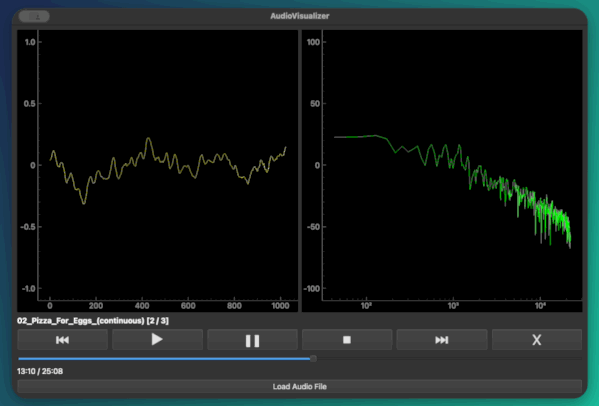

# AUDIO VISUALIZER

Small audio visualizer panel.



Load a WAV file and it plays while two live graphs follow the music:

- **Waveform**: the shape of the sound wave at the current moment (time domain sound signal).
- **Spectrum**: how loud each frequency is (frequency domain sound signal).

## Requirements

- Python 3.15 or newer (developed with Python 3.15)
- Windows, macOS or Linux

## Running

In order to run the project, `uv` must be installed.

From the project root:

```bash
uv run audiovisualizer
```

On some minimal Linux installs the window may fail to open with `Could not load the Qt platform plugin "xcb"`. Installing `libxcb-cursor0` (Debian/Ubuntu: `sudo apt install libxcb-cursor0`) fixes it.

## Usage

1. Click **Load Audio File** and choose a `.wav` file. It starts playing straight away (When a file is opened, every other WAV file in the same folder is added to a playlist, sorted alphanumericaly).
2. Use the controls below the graphs:

| Button      | Action                                                                                       |
| ----------- | -------------------------------------------------------------------------------------------- |
| ⏮          | Restart the current track, or go to the previous track if pressed within the first 3 seconds |
| ►           | Play                                                                                         |
| ❚❚          | Pause                                                                                        |
| ◼           | Stop                                                                                         |
| ⏭          | Next track                                                                                   |
| X / 🔁 / 🔂 | Repeat mode: off, repeat the whole playlist, or repeat the current track                     |
